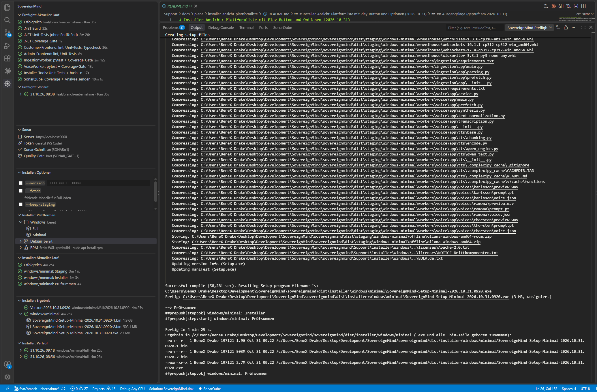

# SovereignMind Preflight

VS-Code-Extension für das Repo `sovereignmind`. Sie hat eine eigene Seite in der Activity Bar und macht zwei Dinge:

- **Preflight** vor dem Push (Build, Tests, Sonar) mit Schritt-Liste, Verlauf und Sonar-Einstellungen.
- **Installer erstellen** (Windows `.exe`, Debian `.run`/`.deb`, RPM) per Play je Plattform und Variante, mit Optionen, Live-Schritten, Ergebnis (Datei, Größe, SHA-256) und Verlauf.

Jeder Lauf schreibt ein Log, das auch eine KI lesen kann. Die Extension enthält selbst keine Prüfung und keinen Build: sie startet die Skripte des Repos und liest deren Ausgabe.



## Voraussetzungen

| Was | Wofür |
|---|---|
| Repo `sovereignmind` als Workspace | Aktivierung bei `Support/scripts/pre-push.sh` oder `Support/scripts/create_installer/create-installer.sh` |
| `bash` (Windows: Git Bash, wird gesucht) | beide Skripte |
| Sonar-Server (`npm run sonar:up`, Standard `http://localhost:9000`) | Sonar-Schritt im Preflight; ohne Server den Schritt ausschalten (Sonar-Ansicht) |
| Installer: dotnet, node, Inno Setup (Windows) bzw. `dpkg-deb` / `rpmbuild` (Debian/RPM, unter Windows über WSL) | Die Plattformliste prüft das vorab mit `create-installer.sh --check`; nicht nutzbare Ziele sind mit Grund markiert |
| Installer: bis ca. 60 GB freier Platz, mehrere Stunden | `full` braucht den Modell-Cache |

Ohne diese Skripte bleibt die Extension inaktiv. In anderen Repos mit `scripts/prepush.sh` läuft der Preflight weiter, der Installer-Bereich fehlt dort.

## Installation

1. `sovereignmind-preflight-<version>.vsix` bauen (siehe unten) oder bekommen.
2. Installieren: `code --install-extension sovereignmind-preflight-<version>.vsix` oder in VS Code Extensions → `…` → „Install from VSIX…“.
3. `Developer: Reload Window`. In der Activity Bar erscheint „SovereignMind“.

Selbst bauen: `npm install && npm run package`.

## Benutzung

### Preflight

- **Preflight: Aktueller Lauf:** Play startet (`PREPUSH_ALL=1`, also alle Teile), ein zweiter Klick stoppt. Darunter Status, Schritte mit Dauer und der Link zum Sonar-Dashboard. Ein Klick auf einen Schritt öffnet das Log an der Stelle.
- **Preflight: Verlauf:** die letzten 20 Läufe; Rechtsklick öffnet das JSON.
- **Sonar:** Server, Token, Schalter „Sonar-Schritt an/aus“ und „Quality Gate hart/weich“.

### Installer

1. **Installer: Optionen:** `--version` (Format `JJJJ.MM.TT.HHMM`), `--fetch` und `--keep-staging`, jeweils mit Checkbox; nur gesetzte Optionen werden übergeben. Die Werte bleiben nach einem Neustart erhalten.
2. **Installer: Plattformen:** Windows, Debian und RPM aufklappen, dort **Full** oder **Minimal** mit Play starten. Nicht nutzbare Plattformen zeigen den Grund (z. B. „WSL fehlt“), die Prüfung (`create-installer.sh --check`) läuft beim Start und über „Aktualisieren“.
3. Play baut **immer komplett neu** (`--mode full --yes`), ohne Rückfrage; Stopp bricht ab. Reicht der freie Platz nicht (`minFreeGbFull` / `minFreeGbMinimal`), erscheint vorher eine Warnung. Die Extension ruft `create-installer.sh` immer mit Argumenten auf, nie das Menü.
4. „Installer: Ergebnis“ zeigt nach dem Lauf Dateien, Größe und SHA-256 aus `dist/installer/last-build.json` (Rechtsklick: im Explorer zeigen, Pfad oder SHA kopieren). „Installer: Verlauf“ listet frühere Läufe.

Es läuft immer nur ein Lauf (Preflight oder Installer). Stoppen beendet den ganzen Prozessbaum; liegengebliebenes Staging räumt `Installer: Staging aufräumen` auf. Beim Schließen von VS Code wird ein laufender Build beendet.

Zum Ausprobieren der Ansicht ohne Build: Einstellung `sovereignmind.installer.dryRun` (`--dry-run`).

### Befehle (Command Palette)

- `SovereignMind Preflight: Ausführen / Stoppen`, `Letztes Log öffnen`, `Log-Pfad kopieren`, `Fehler für KI kopieren`
- `SovereignMind Preflight: Sonar-Server und Token einrichten`, `Sonar-Token entfernen`
- `SovereignMind Preflight: Vorlage im Repo anlegen` (nur für Fremd-Repos ohne Preflight-Skript)
- `SovereignMind Installer: Ansicht öffnen`, `Letztes Log öffnen`, `Log-Pfad kopieren`, `Fehler für KI kopieren`, `Installer-Ordner öffnen`, `Staging aufräumen`

## Einstellungen

| Setting | Standard | Bedeutung |
|---|---|---|
| `sovereignmind.preflight.scriptPath` | `Support/scripts/pre-push.sh` | Preflight-Skript relativ zum Repo-Root (Ersatz: `scripts/prepush.sh`) |
| `sovereignmind.installer.scriptPath` | `Support/scripts/create_installer/create-installer.sh` | Installer-Skript |
| `sovereignmind.shell` | `bash` | Shell; unter Windows wird bei `bash` Git Bash gesucht |
| `sovereignmind.sonarHostUrl` | `http://localhost:9000` | Sonar-Server (`SONAR_HOST_URL`) |
| `sovereignmind.preflight.sonar` | an | Sonar-Schritt ausführen (`SONAR=1\|0`) |
| `sovereignmind.preflight.sonarGate` | an | rotes Quality Gate bricht ab (`SONAR_GATE=1\|0`) |
| `sovereignmind.installer.dryRun` | aus | Installer nur als Trockenlauf |

Alte `prepush.*`-Einstellungen werden einmalig übernommen. Der Sonar-Token liegt im SecretStorage von VS Code; Reihenfolge: VS Code vor `.env`.

## Logs

Pro Art im Repo unter `.prepush/` (in der `.gitignore`):

```
.prepush/preflight/last-run.log    # Rohoutput mit Zeitstempeln (UTC), max. 50 MB (Kopf und Ende)
.prepush/preflight/last-run.json   # Ergebnis, failedStep, Schritte, errorExcerpt, logRange
.prepush/preflight/history/        # die letzten 20 Läufe
.prepush/installer/...             # dasselbe, zusätzlich params und artifacts
```

Der alte Pfad `.prepush/last-run.*` wird beim ersten Lauf nach `preflight/` verschoben. Werte aus allen `*.env` unter `Support/` bzw. `scripts/`, der Sonar-Token sowie `sonar.token=…` und `Authorization:`-Header werden vor dem Schreiben durch `***` ersetzt.

### Marker in den Skripten

Die Skripte geben nur bei `PREPUSH_MARKERS=1` (setzt die Extension) zusätzliche Zeilen aus; sonst bleibt ihre Ausgabe unverändert:

```
##prepush[step:start] windows/minimal: Installer
##prepush[step:ok] windows/minimal: Installer
##prepush[step:fail] sonar
##prepush[link] http://localhost:9000/dashboard?id=<key>
```

Ohne Marker zählt nur der Exit-Code.

## Für KI-Assistenten (CLAUDE.md)

Diesen Block in die `CLAUDE.md` des Repos aufnehmen:

````markdown
## Preflight und Installer-Build

Die VS-Code-Extension „SovereignMind Preflight“ startet `Support/scripts/pre-push.sh` und
`Support/scripts/create_installer/create-installer.sh` und schreibt Logs nach `.prepush/preflight/` bzw. `.prepush/installer/` (nicht versioniert).

**Bei Fehlern in dieser Reihenfolge lesen:**

1. `.prepush/<art>/last-run.json`: `result`, `failedStep`, `steps[]` (`status`, `durationSec`, `errorExcerpt`, `logRange`), bei Installer zusätzlich `params` und `artifacts`.
2. In `last-run.log` nur den Bereich `logRange` des fehlgeschlagenen Schritts lesen.
3. Frühere Läufe: `history/` (die letzten 20).

**Regeln:** Ursache im Code beheben, nicht das Quality Gate anpassen. Installer-Builds dauern Stunden und belegen bis 60 GB; nur auf Ansage starten. Nichts aus `.prepush/` committen, keine Tokens ausgeben.
````

## Plattformen

| System | Stand |
|---|---|
| Windows | Git Bash nötig (wird gesucht); Windows-Installer nur dort; Debian/RPM über WSL. Stoppen nutzt `taskkill`. |
| Linux / macOS | Preflight und Debian/RPM-Installer sollten laufen; Windows-Installer nicht möglich. Nicht getestet. |

## Entwicklung

```bash
npm run build       # bündelt nach dist/
npm run typecheck
npm run package     # baut die .vsix
```

`F5` in VS Code startet einen Extension-Host. Die Dateien unter `templates/` sind Vorlagen für Fremd-Repos (Befehl „Vorlage im Repo anlegen“).

## Lizenz

Proprietär, alle Rechte vorbehalten, siehe [LICENSE](LICENSE).
